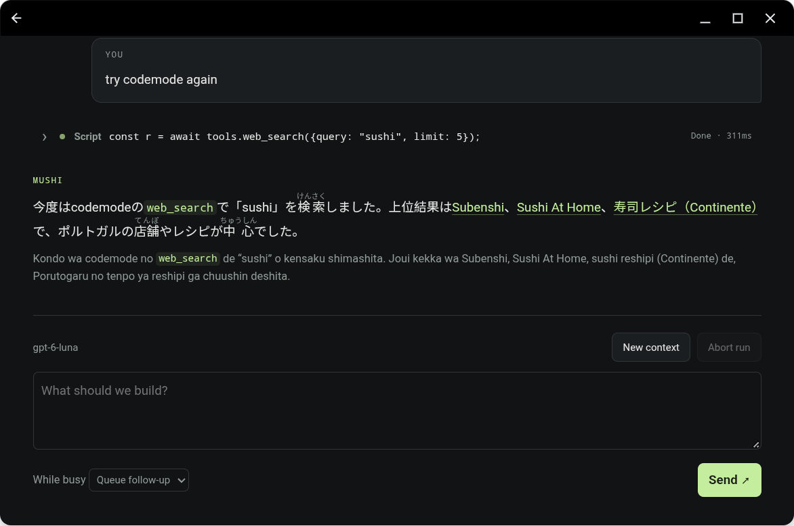

# Mushi


An opinionated Android coding agent built on `@earendil-works/pi-durable@1.3.0`, with a local
WebView UI and a signed Termux ARM64 **Bun 1.4.3** runtime.

- Durable SQLite conversations, interrupted-task recovery and coding tools.
- Filesystem, shell, HTTP, page extraction, web search and QuickJS codemode.
- OpenAI/Anthropic API keys, ChatGPT/Codex and GitHub Copilot device login.
- Markdown, code highlighting, tool cards and Japanese ruby/furigana rendering.
- Foreground service and app-private Unix socket; no public agent TCP listener.



## Build and develop

```sh
git clone --recurse-submodules https://github.com/rcarmo/mushi.git
cd mushi
make install
make check
```

Host checks require Bun, Git, Python 3, a C compiler and `dpkg-deb`. Use Bun for
JavaScript tooling; Node/npm, QEMU and PRoot are not part of the runtime pipeline.
`make preview` serves a credential-free fixture UI at `http://127.0.0.1:4173`.

The Termux repositories under `vendor/` are **Git submodules pinned to exact
commits**, not copied source. Builds export pristine upstream revisions and
apply the maintained `android/` and `native/` overlays. See the
[build guide](docs/building.md#checkout-and-checks) for pins and update rules.

APK builds additionally require JDK 21, Android platform 36, build-tools 36.0.0,
NDK 29.0.14206865, GnuPG and `patchelf`. After configuring `JAVA_HOME` and
`ANDROID_HOME`:

```sh
bun run android:build
```

The APK is written under `build/android/termux-app/app/build/outputs/apk/debug/`.
The default pipeline downloads hash-locked Android packages and compiles a small
native bridge; it does not rebuild the userland. The reviewed target is
**arm64-v8a, Android API 28+**. Target SDK 28 preserves Termux execution
compatibility; this is a development project, not a Play Store-ready build.
See [building](docs/building.md) for ARM64 host setup, signing and lock updates.

## Use and limitations

Install the APK, open Mushi, tap **Start**, then choose a provider and model in
**Settings**. Device login requires approval on the provider's fixed verification
page. API keys use the provider's API billing. See
[getting started](docs/getting-started.md) for authentication and updates.

The agent can execute commands with the app's permissions. **It is not sandboxed
from its own credentials**, which are app-private plaintext. Prompt rules are
not a security boundary. Backups are disabled; uninstalling erases app data.
Updates require a matching signing certificate, and the extracted native prefix
is not automatically upgraded. Background recovery remains subject to Android
force-stop, Doze and OEM restrictions. External effects are not exactly-once.

Host fixtures do not establish Android/device or live-provider behaviour. Record
those checks separately; see [testing](docs/testing.md) and
[security](docs/security.md) before distributing builds or sharing diagnostics.

## Documentation

| Guide | Contents |
| --- | --- |
| [Getting started](docs/getting-started.md) | Installation, sign-in and daily use |
| [Architecture](docs/architecture.md) | Components, lifecycle and source map |
| [Building](docs/building.md) | Toolchains, pinned dependencies, APKs and signing |
| [Tools](docs/tools.md) | Filesystem, shell, HTTP and web tools |
| [Codemode](docs/codemode.md) | Script API, limits and recovery |
| [Protocol](docs/protocol.md) | Private socket and native bridge |
| [Security](docs/security.md) | Trust boundaries, credentials and limitations |
| [Testing](docs/testing.md) | Host, runtime and device verification |
| [Troubleshooting](docs/troubleshooting.md) | Startup, authentication and recovery |
| [Contributing](CONTRIBUTING.md) | Development and review workflow |

## License

GPL-3.0-only integration with upstream exceptions preserved. See [NOTICE.md](NOTICE.md)
and `licenses/` for Termux, Pi/Chord, Kintsugi and dependency attribution.
Redistributing runtime packages requires satisfying their corresponding-source
obligations; a package inventory or upstream URL alone is insufficient.
